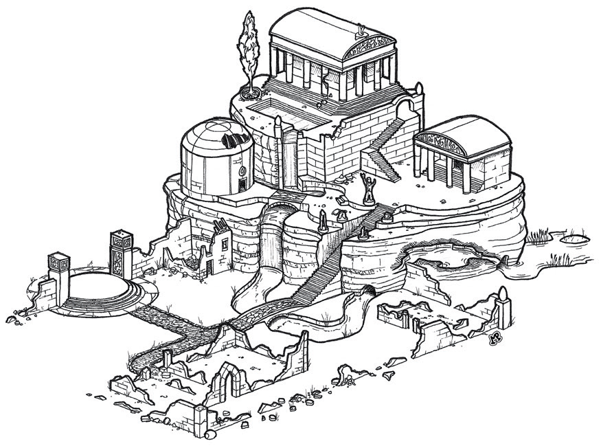

# Temple of Raei

There is an old temple mound to [Raei](Raei.md) outside of [Hammerkeep](Hammerkeep.md) somewhere in the twisty depths of the [Copper Hills](CopperHills.md). It's been abandoned for decades and any trails to it are long overgrown, but at one time it had a library.
## Rumours

There've been a few travellers out through the Hills last year who claim they were attacked by bandits in the area. Some rumours claim those bandits are holed up in the old [Hollow mine](Hollow.md), some say they heard someone escaped from the bandits from a stone building with "a reeking cesspit of a pool" that could be this temple. The [Warden's](WardenofHammerkeep.md) rangers didn't find anything out there (though the Warden's patrols are seen as pretty useless in general).

<!--In [IC4996](IC4996.md) it's being used as a bandit base of operations by the [Blighted Order](BlightedOrder.md). They have somehow been spared the [Sereno](Sereno.md) illness.-->

> [places](places.md)
> [temples](temples)
> [factions](factions.md)